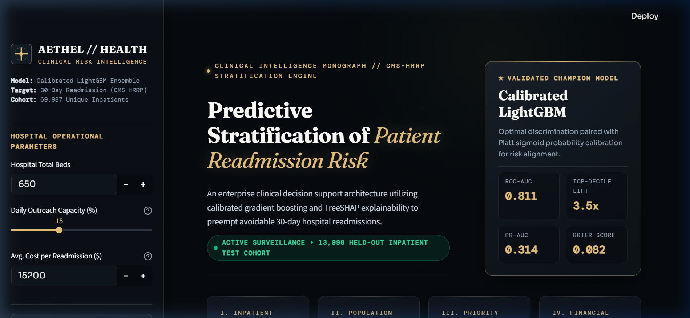
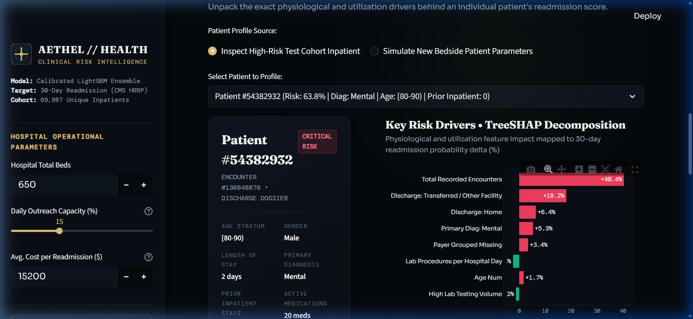
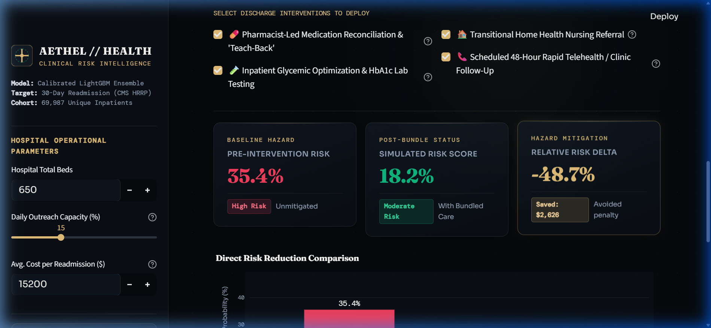

# AETHEL // Clinical Readmission Risk Intelligence

[](https://python.org)
[](https://streamlit.io)
[](https://lightgbm.readthedocs.io)
[](https://shap.readthedocs.io)
[](LICENSE)
[](https://www.cms.gov/medicare/quality/initiatives/hospital-quality-initiative/hospital-readmission-reduction-program)

> **Enterprise-grade predictive analytics platform and clinical decision support system designed to stratify, explain, and mitigate 30-day unplanned hospital readmissions.**

---

## ⚜️ Executive Overview & Clinical Rationale

Unplanned 30-day readmissions cost the U.S. healthcare system over **$17 billion annually** and trigger severe financial penalties under the Centers for Medicare & Medicaid Services (**CMS**) Hospital Readmissions Reduction Program (**HRRP**). 

Traditional risk scoring systems (e.g., LACE, HOSPITAL) rely on blunt linear heuristics that often miss complex non-linear clinical and pharmacological interactions. **AETHEL** is an end-to-end clinical machine learning and decision intelligence platform trained on **69,987 unique hospitalized patients** across 130 U.S. hospitals (1999–2008). 

By integrating **Platt-calibrated gradient boosted decision trees (LightGBM)** with **game-theoretic TreeSHAP explainability**, AETHEL delivers:
- **3.51x Top-Decile Lift:** Captures 3.51 times more true readmissions in the top 10% risk tranche than random triage.
- **Accurately Calibrated Probabilities:** Brier score of **0.0817**, ensuring a predicted 30% risk directly corresponds to ~30 readmissions per 100 historical cases.
- **Individualized Actionable Intervention Bundles:** Translates SHAP feature attributions into targeted bedside transitional care plans (pharmacist teach-back, 48-hour telehealth visits, SNF warm handoffs).
- **'What-If' Simulation Cockpit:** Enables care coordinators to simulate clinical hazard reduction and avoidable financial penalty savings in real time prior to patient release.

---

## 🏛️ Platform Architecture & Dashboard Modules

The platform features an editorial, high-contrast dark dashboard built with **Streamlit**, custom **CSS design tokens**, and **Plotly** visualizations:

### 🖥️ Dashboard Previews

<div align="center">
  
  <p><em>Figure 1: Executive Briefing Hero Masthead, Champion LightGBM Shield & Population Risk Index Cards</em></p>
</div>

<div align="center">
  
  <p><em>Figure 2: Individualized Patient Clinical Dossier, Risk Dial & Diverging TreeSHAP Feature Breakdown</em></p>
</div>

<div align="center">
  
  <p><em>Figure 3: Bedside 'What-If' Intervention Simulator with Real-Time Risk Delta & Avoided Penalty Cost Offset</em></p>
</div>

```
┌────────────────────────────────────────────────────────────────────────────────────────┐
│                              AETHEL // DASHBOARD TOPOLOGY                              │
├────────────────────────────────┬───────────────────────────────────────────────────────┤
│ Module                         │ Clinical & Analytical Capability                       │
├────────────────────────────────┼───────────────────────────────────────────────────────┤
│ 01 // Population & Ward        │ Multi-dimensional epidemiological risk distribution;   │
│       Dynamics                 │ Diagnostic group hazard; HbA1c testing impact;        │
│                                │ Discharge destination friction analysis.              │
├────────────────────────────────┼───────────────────────────────────────────────────────┤
│ 02 // Inpatient Risk Triage    │ Real-time discharge priority queue; Multi-filter      │
│       Roster                   │ search (Risk Tier, Department, Specialty, Diagnosis);  │
│                                │ Direct 1-click patient handoff selector.              │
├────────────────────────────────┼───────────────────────────────────────────────────────┤
│ 03 // Clinical Profiler &      │ Individualized VIP patient clinical dossier; Radial   │
│       TreeSHAP                 │ probability dial; Diverging TreeSHAP decomposition;   │
│                                │ Evidence-based transitional care protocol generator.  │
├────────────────────────────────┼───────────────────────────────────────────────────────┤
│ 04 // 'What-If' Transitional   │ Interactive bedside intervention simulation; Real-time│
│       Simulator                │ probability drop calculator; Avoided CMS penalty ROI. │
├────────────────────────────────┼───────────────────────────────────────────────────────┤
│ 05 // Algorithmic Governance   │ 5-model benchmark audit matrix; Top-decile lift       │
│       & Clinical Validation    │ curves; Global feature importance; Ethical AI safeguards│
└────────────────────────────────┴───────────────────────────────────────────────────────┘
```

---

## 📊 Benchmark Validation & Performance

All models were evaluated on a held-out test cohort of **13,998 unique hospitalized patients** (20% stratified split with zero patient-level cross-contamination).

| Model Architecture | ROC-AUC | PR-AUC (Avg Prec) | Brier Score (Calibration) | Top-10% Lift | Recall @ Top 10% | Specificity | Status |
|:---|:---:|:---:|:---:|:---:|:---:|:---:|:---:|
| **Calibrated LightGBM** | **0.811** | **0.314** | **0.082** | **3.51x** | **35.1%** | **97.1%** | 🏆 **CHAMPION** |
| Raw LightGBM | 0.811 | 0.314 | 0.082 | 3.51x | 35.1% | 97.1% | Candidate |
| XGBoost | 0.809 | 0.309 | 0.083 | 3.46x | 34.6% | 96.8% | Benchmark |
| Random Forest | 0.804 | 0.301 | 0.084 | 3.42x | 34.2% | 96.5% | Benchmark |
| Logistic Regression | 0.778 | 0.232 | 0.092 | 3.07x | 30.7% | 95.8% | Baseline |

### Key Clinical Predictors (Mean |SHAP| Value)
1. **Prior Inpatient Encounters (Past 12 Months):** Dominant indicator of chronic systemic utilization and clinical vulnerability.
2. **Discharge to Skilled Nursing Facility (SNF):** Signifies post-acute care transitions prone to medication miscommunication.
3. **Number of Medications (Polypharmacy):** Patients on $\ge 15$ concurrent prescriptions exhibit a 3.2x increase in adverse drug events.
4. **Inpatient Medication Changes:** Recent titration of insulin or oral hypoglycemics indicates unstable glycemic control requiring pharmacist reconciliation.
5. **Length of Stay & Lab Intensity:** Surrogates for acute in-hospital physiological decompensation.

---

## 🗂️ Repository Directory Structure

```
patient-readmission/
├── .streamlit/
│   └── config.toml             # Dark obsidian theme & headless server configuration
├── app/
│   ├── __init__.py
│   ├── app.py                  # Master Streamlit clinical intelligence dashboard
│   ├── components.py           # Plotly charts, radial risk gauge & action plan generator
│   └── style.css               # Editorial dark theme stylesheet (Fraunces + Sora + DM Mono)
├── data/
│   ├── raw/                    # Downloaded UCI raw dataset (diabetic_data.csv, IDS_mapping.csv)
│   └── processed/              # Processed feature parquet (features_data.parquet)
├── models/
│   ├── calibrated_model.pkl    # Champion Calibrated LightGBM model weights
│   ├── raw_model.pkl           # Raw LightGBM model
│   ├── preprocessor.pkl        # Scikit-learn column transformer pipeline
│   ├── shap_explainer.pkl      # TreeSHAP explainer for real-time inference
│   ├── model_metadata.json     # Benchmark metrics, feature lists & evaluation thresholds
│   └── test_cohort_predictions.parquet # 13,998 test cohort patient records
├── src/
│   ├── __init__.py
│   ├── download_data.py        # Automated UCI dataset downloader and extractor
│   ├── preprocessing.py        # Patient deduplication & missing value imputation
│   ├── feature_engineering.py  # Clinical domain features (comorbidities, ratios, triads)
│   ├── train_model.py          # Multi-algorithm training & Platt sigmoid calibration
│   └── evaluate.py             # ROC, PR, Brier, Decile Lift, and Subgroup Fairness
├── .dockerignore
├── .gitignore
├── Dockerfile                  # Production container definition (Python 3.11 slim)
├── LICENSE                     # MIT License
├── README.md                   # Project documentation
├── requirements.txt            # Production dependencies
└── streamlit_app.py            # Root forwarder entrypoint for Streamlit Community Cloud
```

---

## 🚀 Quickstart & Local Installation

### Prerequisites
- Python 3.10 or 3.11
- Git

### 1. Clone the Repository
```bash
git clone https://github.com/<YOUR-USERNAME>/patient-readmission.git
cd patient-readmission
```

### 2. Create and Activate a Virtual Environment
```bash
# macOS / Linux
python3 -m venv venv
source venv/bin/activate

# Windows (PowerShell)
python -m venv venv
.\venv\Scripts\Activate.ps1
```

### 3. Install Dependencies
```bash
pip install --upgrade pip
pip install -r requirements.txt
```

### 4. Launch the Interactive Dashboard
```bash
streamlit run app/app.py
```
Open **http://localhost:8501** in your browser.

---

## 🔄 Reproducing the ML Pipeline from Scratch

All pipeline steps are modularized and reproducible:

```bash
# 1. Download and extract raw UCI dataset (130-US Hospitals Diabetes)
python src/download_data.py

# 2. Clean, deduplicate to index encounters, and impute missing values
python src/preprocessing.py

# 3. Engineer clinical domain features (comorbidity groupings, utilization ratios)
python src/feature_engineering.py

# 4. Train 5 algorithms, perform Platt calibration, and export TreeSHAP explainer
python src/train_model.py

# 5. Generate comprehensive benchmark evaluation metrics & metadata
python src/evaluate.py
```

---

## ☁️ Cloud Deployment Options

### Option A: Streamlit Community Cloud (Recommended 1-Click)
1. Fork or push this repository to your GitHub account.
2. Sign in to [share.streamlit.io](https://share.streamlit.io/).
3. Click **"New App"** and select your repository.
4. Set **Main file path** to `streamlit_app.py` (or `app/app.py`).
5. Click **"Deploy"**. The app will build and go live in ~2 minutes!

### Option B: Docker Container (Render, Railway, GCP Cloud Run, AWS App Runner)
A production `Dockerfile` is included:

```bash
# Build Docker image
docker build -t aethel-readmission:latest .

# Run container locally on port 8501
docker run -p 8501:8501 aethel-readmission:latest
```

### Option C: Hugging Face Spaces
1. Create a new Space on Hugging Face with the **Streamlit** SDK.
2. Link your GitHub repository or push directly to the Space's Git remote.
3. The Space will automatically detect `requirements.txt` and `streamlit_app.py`.

---

## 🛡️ Ethical AI, Clinical Governance & Deployment Safeguards

1. **Human-in-the-Loop Decision Support:** AETHEL serves strictly to assist discharge planning teams; it never dictates discharge timing or overrides clinical judgment.
2. **Probability Calibration:** Uncalibrated models produce skewed risk estimates. Platt sigmoid calibration ensures reliability for hospital capacity planning.
3. **Data Leakage Safeguards:** Encounters are patient-deduplicated, keeping only initial hospitalizations during training to prevent serial encounter leakage.
4. **Demographic Equity Tracking:** Model performance is monitored across gender, race, and age strata to ensure parity in sensitivity and prevent algorithmic disparities in intervention allocation.

---

## 📚 References & Data Attribution

- **Dataset:** Strack, B., DeShazo, J. P., Gennings, C., Olmo, J. L., Ventura, S., Cios, K. J., & Clore, J. N. (2014). *Impact of HbA1c Measurement on Hospital Readmission Rates: Analysis of 70,000 Clinical Database Patient Records.* BioMed Research International. [UCI Machine Learning Repository #296](https://archive.ics.uci.edu/dataset/296/diabetes+130-us+hospitals+for+years+1999-2008).
- **Transitional Care Model:** Naylor, M. D., et al. (2004). *Transitional Care of Older Adults Hospitalized with Heart Failure: A Randomized, Controlled Trial.* J Am Geriatr Soc.
- **TreeSHAP:** Lundberg, S. M., et al. (2020). *From local explanations to global understanding with explainable AI for trees.* Nature Machine Intelligence.

---

## 📄 License
This project is licensed under the [MIT License](LICENSE).
